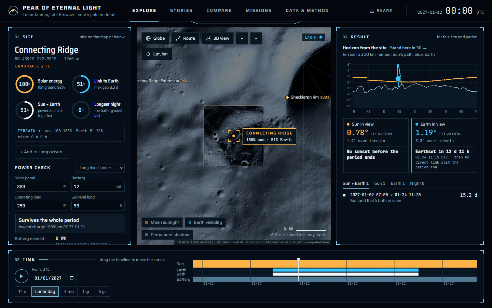

# Peak of Eternal Light

Sunlight and direct-to-Earth visibility at lunar landing sites, computed from LRO LOLA terrain and
NASA/JPL ephemerides. NASA Space Apps Challenge 2026, challenge *Lunar Landing Site Navigator*.

Web application: https://peak-of-eternal-light.pages.dev



## Summary

A lander on the lunar surface depends on two geometric conditions: the Sun above the local horizon for
power and Earth above it for direct radio contact. At high southern latitudes the Sun stays within about
1.5° of the mathematical horizon, so terrain up to a few hundred kilometres away controls both. We compute
the terrain horizon of a site from LOLA digital elevation models, the topocentric positions of the Sun and
Earth from SPICE ephemerides, and the visible fraction of each disc above that horizon over time. From
these series the application derives windows of illumination and contact, the time to the next sunset or
Earthset, and the energy balance of a solar-powered craft. All analysis after data preparation runs in the
browser.

## Method

**Ephemeris.** We evaluate the positions of the Sun and Earth relative to the Moon's centre in the MOON_ME
frame (DE440 aligned to DE421 mean Earth/polar axes, the frame of the LOLA products) with SPICE, light
time and stellar aberration corrected. The browser receives these vectors at 6 h steps from July 1969 to
2036 (2.2 MB) and interpolates them with a cubic Lagrange polynomial; the direction error stays below
2·10⁻⁵°. Nodes are uniform in UTC, as JavaScript dates are. Topocentric elevation and azimuth follow from
the site position on a 1737.4 km sphere and its local east-north-up basis.

**Horizon.** For each of 720 or 1440 azimuths we march along a great circle and record the maximum
elevation angle of the terrain, `atan2(r cos θ − r₀, r sin θ)`, where r is the terrain radius at angular
distance θ and r₀ the radius of the observer, 2 m above the ground. Curvature enters through this
expression, so no separate correction applies. The terrain source depends on location:

| Location | Near terrain | Distant terrain (to 300 km) | Computed |
|---|---|---|---|
| Catalog sites, south pole | 5 m LOLA and shape-from-shading | 20, 40, 120 m LOLA | in advance |
| Any point, 60–90°S | 80 or 120 m LOLA tiles, to 33–47 km | grid of horizons at 2 or 5 km spacing, corrected for eye height | in the browser |
| Landing sites, 60°S–60°N | 59 m SLDEM2015, to 40 km | 474 m LOLA to 100 km, 1.9 km beyond | in advance |
| Any other point | 474 m LOLA, to 100 km | 1.9 km LOLA | in the browser |

Interpolating complete horizons between grid nodes fails on peaks and crater rims (27% instead of 87%
sunlight at Connecting Ridge), because neighbouring nodes see different near terrain. We therefore
interpolate only the distant part and trace the near part at the exact point.

**Illumination and visibility.** We treat the horizon as straight across the solar disc (0.27° radius) and
compute the visible area fraction of the disc from the elevation of its centre above the horizon. Earth
counts as visible when any part of its disc clears the horizon. Mean disc fraction gives the energy share;
contiguous runs give windows, the longest night and the longest contact gap. Event times (sunset, sunrise,
Earthset, Earthrise) are refined to one minute by bisection between time steps.

**Power.** A vertical panel tracks the Sun in azimuth, so output equals peak power times disc fraction
times the cosine of solar elevation. The craft runs its operating load while the panel covers it and a
survival load on the battery otherwise, with charging efficiency applied. We report whether the battery
empties within the period and the smallest capacity that never empties.

**Uncertainty.** For eight candidate sites, Barker et al. (2021) provide 100 realisations of the 5 m
terrain within the LOLA error. We recompute every metric on each and report the 5th–95th percentile range.
For any site we also offer a scan of 37 points on three hexagonal rings within 0.5–5 km, which shows how
the result depends on the touchdown point and its local slope.

## Data

| Product | Resolution | Use | Source |
|---|---|---|---|
| LOLA site DEMs and 100 terrain realisations (Barker et al. 2021) | 5 m | catalog horizons, uncertainty | [PGDA 78](https://pgda.gsfc.nasa.gov/products/78) |
| LOLA south polar DEMs, permanent shadow maps (Barker et al. 2023) | 20–240 m | polar horizons, map | [PGDA 90](https://pgda.gsfc.nasa.gov/products/90) |
| Shape-from-shading DEMs of Artemis III regions (Bertone et al.) | 5 m | catalog near terrain | [Zenodo](https://doi.org/10.5281/zenodo.17954508) |
| Mean illumination and Earth visibility (Mazarico et al. 2011) | 60–240 m | validation, map, route search | [PGDA 69](https://pgda.gsfc.nasa.gov/products/69) |
| SLDEM2015, LOLA with Kaguya Terrain Camera (Barker et al. 2016) | 59 m | landing sites off the pole | [PGDA 54](https://pgda.gsfc.nasa.gov/products/54) |
| LOLA GDR global topography | 474 m | any point off the pole | [PDS](https://pds-geosciences.wustl.edu/missions/lro/lola.htm) |
| SPICE kernels: DE440, lunar orientation, leap seconds | | ephemeris | [NAIF](https://naif.jpl.nasa.gov/pub/naif/generic_kernels/) |
| CGI Moon Kit: LROC WAC mosaic, LOLA topography | | globe | [SVS 4720](https://svs.gsfc.nasa.gov/4720) |

Mission dates, sites and outcomes come from NASA CLPS pages, the Apollo Lunar Surface Journal and agency
sources listed per mission in `data/missions.yaml`.

## Validation

| Test | Reference | Result |
|---|---|---|
| Mean solar disc fraction, 229 stratified pixels, 18.6 years hourly | Mazarico et al. maps, 60 m | r = 0.995, bias −0.6 pp, 90% within ±4.0 pp |
| Mean Earth visibility, same pixels | Mazarico et al. maps, 60 m | r = 0.995, bias +1.1 pp, 90% within ±4.4 pp |
| Browser horizon of arbitrary points vs. 5 m horizons, annual sunlight | Python pipeline | median 0.2 pp at catalog sites, 0.3 pp nearby; 90% within 1.6 pp |
| Solar elevation at Apollo 11 and 12 touchdown | Apollo Lunar Surface Journal: 10.65°, 5.19° | 10.70°, 5.14° |
| Chandrayaan-3 sunset | ISRO put Vikram to sleep on 4 Sep 2023 | sunset 4 Sep 2023, sunrise 19–20 Sep |
| IM-1 sunset | end of operations, early March 2024 | sunset 2 Mar 2024 |
| Blue Ghost 1 end of daylight, 16 Mar 2025 | Firefly: 346 h of daylight after 08:34 UTC landing; last data 23:15 UTC, ~5 h into night; hence 18:15–18:35 UTC | disc starts to set 18:42, gone 19:48 (474 m terrain: 19:16, 20:22) |
| Browser formulas vs. Python | 128 automated tests | elevations within 3·10⁻⁶°, horizons within 0.01° |

For the map comparison we place the observer 2 m above the pixel centre on 40 m terrain, matching the map
resolution. On the surface itself the solar bias grows to −3.9 pp; the difference arises within the first
few hundred metres, which is why catalog sites use 5 m terrain.

## Limitations

Off the pole and outside the twelve precomputed landing sites, the 474 m terrain smooths crater rims and
hills, and sunrise or sunset can shift by one to two hours. At the precomputed sites the nearest few
hundred metres remain close to the 59 m grid spacing. Slopes come from 80–474 m terrain and underestimate
real slopes. The power model uses order-of-magnitude presets, not the parameters of specific craft. No
rover traverses at the south pole have been published, so the example route is hypothetical. The landing
point matters at the kilometre scale: the Shackleton rim tile centre lies on a 33° inner slope with 9%
sunlight and a 204-day longest night, while a point on the crest 1.9 km away has a 1° slope, 85% sunlight
and a 2.8-day longest night.

## Application

The interface has three columns: site (left), time (bottom) and result (right). Colour encodes one
quantity each: amber for the Sun, cyan for Earth only, white for both. Functions:

| Function | Description |
|---|---|
| Explore | catalog site, any clicked point or typed coordinates; horizon with tracks, windows, countdowns |
| Power check | battery survival, empty time, minimum capacity |
| Best landing dates | survival of a mission of given length for each landing day of a year |
| Missions | CLPS deliveries to September 2026, Apollo, Chang'e, SLIM, Chandrayaan-3, impact sites |
| Compare | all catalog sites; user scenarios of place and dates aligned by days since landing |
| Around this spot | 37-point sensitivity scan and gentler, sunnier points nearby |
| Rover traverse | horizon and energy along a route; least-darkness path over NASA mean illumination maps |
| 3D views | terrain from the observer's eye or from above, lit by the computed Sun direction |
| Stories | five guided tours built from saved application states |

Every view is encoded in the page address and can be shared as a link.

## Reproduction

The generated site data (about 0.9 GB) is published as a `data-YYYY-MM-DD` release of this repository.
With Python 3, Node.js and the GitHub CLI:

```bash
git clone https://github.com/RenatTOP/peak-of-eternal-light && cd peak-of-eternal-light
python -m pipeline.data_release fetch       # site data -> web/public/data, data/derived
cd web && npm install && npm run dev        # http://localhost:5173
```

To rebuild the data from the NASA products (about 80 GB):

```bash
pip install -r requirements.txt
python -m pipeline.fetch_data --all         # LOLA products and clones; SfS from Zenodo by hand
python -m pytest -q
python -m pipeline.build_web                # ephemeris, catalog horizons, map tiles, overlays, globe
python -m pipeline.dem_tiles                # 80/120 m terrain tiles
python -m pipeline.fetch_data --groups global && python -m pipeline.global_tiles
python -m pipeline.landing_horizons         # SLDEM2015 windows read over HTTP, ~1.5 GB
python -m pipeline.grid                     # distant-horizon grid, ~1 h
python -m pipeline.zone_map                 # illumination for 60-66°S
python -m pipeline.vis_tiles
python -m pipeline.uncertainty && python -m pipeline.build_web --only clones
python -m pipeline.validate --height 2      # comparison with the Mazarico maps
```

`python -m pipeline.point --lat -80.13 --lon 1.44 --start 2024-02-22 --days 60` analyses a single point
from the command line. In `web/`, `npm test` runs the browser tests and `npm run build` produces the static
site.

Repository layout: `pipeline/` (Python processing), `web/` (application and its tests), `data/` (site and
mission catalogs; NASA data downloads here and stays out of git), `tests/` (Python tests), `docs/`
(submission text). Coordinates use east-positive longitude, azimuth
clockwise from north and heights above a 1737.4 km sphere; polar products use polar stereographic
projection (`+proj=stere +lat_0=-90 +lat_ts=-90 +R=1737400`).

## Use of AI

Parts of the code and data pipeline were written with an AI coding assistant
(Anthropic Claude), which was also used for literature and mission research and to interpret validation
results. No data, results or images in the application are AI-generated, except for the logo, the team
avatar and the mission patches, which are clearly marked as such:
every number is computed by the model described above from the listed NASA products and checked by
automated tests against Python references, NASA maps and mission events.

## References

- Barker M. K. et al. (2016). A new lunar digital elevation model from the Lunar Orbiter Laser Altimeter and SELENE Terrain Camera. *Icarus* 273, 346. doi:10.1016/j.icarus.2015.07.039
- Barker M. K. et al. (2021). Improved LOLA elevation maps for south pole landing sites. *Planet. Space Sci.* 203, 105119. doi:10.1016/j.pss.2020.105119
- Barker M. K. et al. (2023). A new view of the lunar south pole from the Lunar Orbiter Laser Altimeter. *Planet. Sci. J.* 4, 183. doi:10.3847/PSJ/acf3e1
- Bertone S. et al. *Planet. Sci. J.* doi:10.3847/PSJ/ae5b70
- Mazarico E. et al. (2011). Illumination conditions of the lunar polar regions using LOLA topography. *Icarus* 211, 1066. doi:10.1016/j.icarus.2010.10.030
